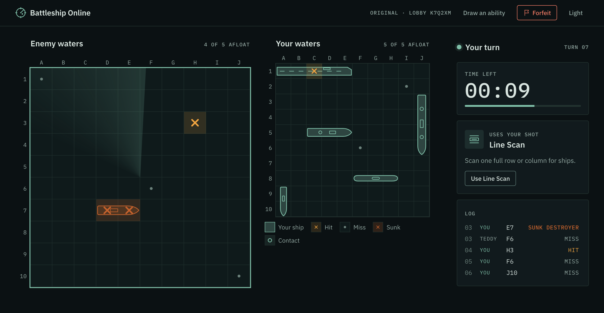
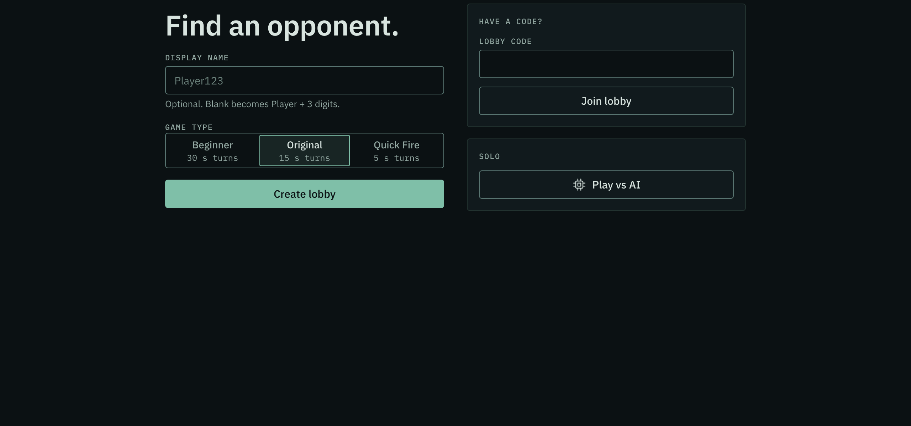
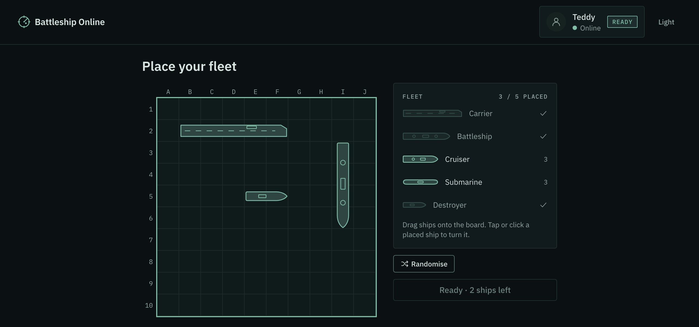
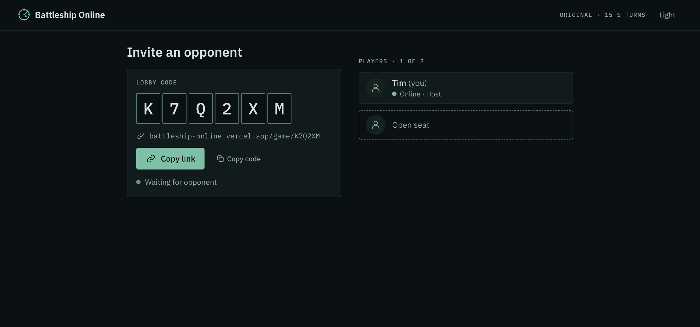
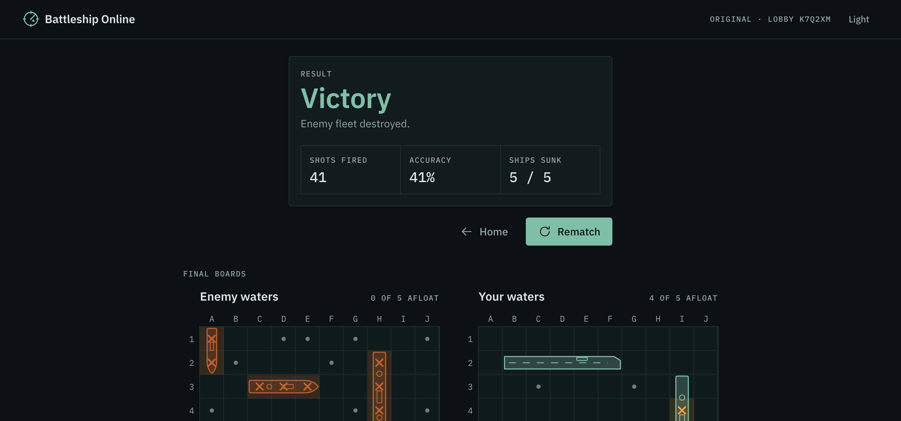
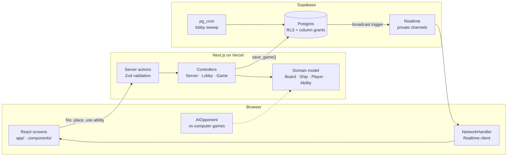

<div align="center">

<picture>
  <source media="(prefers-color-scheme: dark)" srcset="public/brand/mybattleship-mark-on-dark.svg">
  
</picture>

# Battleship Online

**Real-time two-player Battleship in the browser.**<br>
Share a lobby code, place your fleet, race the turn clock, and turn the game with four special abilities. Or warm up against the computer.

### [▶ Play it live](https://battleship.timcrafts.vercel.app)

[](https://github.com/queeeety/battleship-online/actions/workflows/ci.yml)




</div>

## Features

- **Online multiplayer, no sign-up.** Create a lobby and share its six-character code. Codes skip 0/O, 1/I and L, so they're easy to read out. Every player gets an anonymous session behind the scenes.
- **Three game types.** Beginner gives you 30 seconds a turn, Original 15 and Quick Fire 5. If the clock runs out, a random shot is fired for you.
- **Four comeback abilities.** Lose a ship and you draw one at random to fight back with:

  | Ability | What it does |
  |---|---|
  | **Double Shot** | Your next miss this turn doesn't end the turn. |
  | **Radar Sweep** | Reveals which squares in a 3×3 area hide a ship. |
  | **Line Scan** | Reveals ship squares along a whole row or column. |
  | **Reroute** | Moves one undamaged ship to a new spot, away from squares already fired at. |

- **Play against the computer.** On Easy it fires at random. On Normal it hunts on a checkerboard, then follows a ship's direction once it scores adjacent hits. It never looks at your board. The whole game runs in your browser and survives a page reload.
- **Built for real networks.** A dropped player has 60 seconds to come back before the game counts as a forfeit, and a banner on the home page offers to rejoin. Abandoned lobbies are cleaned up on a schedule.
- **Rematch** with one click when the game ends.
- **Polish.** Drag-and-drop fleet placement, hit, miss and sink effects, sound effects and music with a mute toggle, keyboard navigation on the boards, light and dark themes, and layouts for phones, tablets and desktops.

## Screenshots

<table>
  <tr>
    <td></td>
    <td></td>
  </tr>
  <tr>
    <td align="center">Home</td>
    <td align="center">Fleet placement</td>
  </tr>
  <tr>
    <td></td>
    <td></td>
  </tr>
  <tr>
    <td align="center">Lobby</td>
    <td align="center">Result</td>
  </tr>
</table>

## How it works

The game is **server-authoritative**. Browsers never see the opponent's fleet, and every move is checked on the server before it counts.



- **Hidden information stays hidden.** Fleets live in a table only the server's service role can read. Players read their own game through row-level security and column grants, so nobody can query the opponent's ships or abilities.
- **One write path.** Moves go through Next.js server actions. They validate the input with Zod, load the game into the domain model, apply the rules, and save the result in a single `save_game()` database call.
- **Live updates.** A database trigger broadcasts every change on a private Realtime channel that only the two seated players can join. Presence shows when an opponent drops.
- **Designed before it was coded.** The project started as UML: use cases, class, state, sequence and communication diagrams. The code keeps the same entity, boundary and control split, so `lib/entities`, `lib/boundary` and `lib/controllers` map straight onto the [diagrams](docs/uml/).

## Tech stack

| Layer | Tools |
|---|---|
| Front end | Next.js 16 (App Router), React 19, TypeScript, Tailwind CSS 4, Framer Motion |
| Back end | Next.js server actions, Zod, Supabase (Postgres, anonymous auth, Realtime, pg_cron) |
| Testing | Vitest unit tests for the rules, abilities, AI, server validation and UI logic |
| Delivery | GitHub Actions (CI, database migrations), Vercel |

## Project structure

```text
app/                  routes: home, /game/[code] (online), /play (vs computer), /design (dev-only showcase)
components/           design system and game UI: boards, ships, ability cards, effects, screens
hooks/                game state, placement, sounds, timers
lib/
  entities/           Board, Cell, Coordinate, the five ship classes, players and the AI
  abilities/          Ability base class and the four abilities
  controllers/        Game, Lobby and Server: the rules and the turn flow
  boundary/           UI and network boundary classes from the class diagram
  server/             server actions, GameRepository, SessionManager, RequestValidator, RateLimiter
supabase/migrations/  schema, RLS, the save_game function, Realtime permissions, the cron sweep
docs/uml/             PlantUML sources for every diagram
tests/                Vitest tests, mirroring lib/
```

## Run it locally

You need **Node 22+** and a free [Supabase](https://supabase.com) project.

1. **Install**

   ```bash
   git clone https://github.com/queeeety/battleship-online.git
   cd battleship-online
   npm install
   ```

2. **Add your keys.** Copy `.env.example` to `.env.local` and fill it in from Supabase → Project Settings → API Keys.

   | Variable | Where it's used |
   |---|---|
   | `NEXT_PUBLIC_SUPABASE_URL` | browser and server |
   | `NEXT_PUBLIC_SUPABASE_PUBLISHABLE_KEY` | browser and server, safe to expose |
   | `SUPABASE_SECRET_KEY` | server only, bypasses row-level security |
   | `UPSTASH_REDIS_REST_URL`, `UPSTASH_REDIS_REST_TOKEN` | optional, rate-limits lobby creation |

3. **Create the database.**

   ```bash
   npx supabase login
   npx supabase link --project-ref <your-project-ref>
   npx supabase db push --remote
   ```

   Then turn on **Authentication → Sign In / Providers → Allow anonymous sign-ins** in the Supabase dashboard.

4. **Play.** Run `npm run dev` and open <http://localhost:3000>. To play online against yourself, use a second browser or a private window. The design-system showcase is at <http://localhost:3000/design>.

| Command | What it does |
|---|---|
| `npm run dev` | dev server |
| `npm test` | Vitest suite |
| `npm run lint` | ESLint |
| `npm run typecheck` | TypeScript |
| `npm run build` | production build |

## Deployment

Vercel builds every push to `main`, with the Supabase keys stored as encrypted environment variables in the Vercel project. GitHub Actions does the rest. Its keys live in encrypted Actions secrets (`SUPABASE_ACCESS_TOKEN`, `SUPABASE_DB_PASSWORD`, `SUPABASE_SECRET_KEY`), and the non-secret project ref in the `SUPABASE_PROJECT_ID` variable:

| Workflow | When | What |
|---|---|---|
| [CI](.github/workflows/ci.yml) | every push and pull request | lint, typecheck, tests, production build |
| [Database migrations](.github/workflows/db-migrations.yml) | a new file in `supabase/migrations` reaches `main` | `supabase db push` to the hosted project |
| [Keep Supabase awake](.github/workflows/keep-alive.yml) | every three days | one database read, so the free project never pauses |

## Team

Built in autumn 2026 by five students as the group project for the Object-Oriented Analysis and Design module at Dublin City University.

| | Main areas |
|---|---|
| **Tymofii Bezverkhyi** | Design system and UI components, every game screen, wiring the screens to the back end (online play from home to rematch, the in-browser computer game), drag-and-drop placement and ability targeting, mobile layouts, CI/CD and deployment, class diagrams |
| **Nathan Pascale** | Supabase schema and security, server actions, sessions, Realtime networking, lobbies, disconnects and forfeits, rematch, turn timer, rate limiting |
| **Chukwuma Anyanwu** | Rules engine, the computer opponent, saving and restoring games |
| **Alexander Abramov** | Sound and music, hit, miss and sink effects, error states, keyboard navigation, turn countdown |
| **Teddy Essomba** | The four abilities and their targeting, use case diagrams |

Originally developed on the university's GitLab and mirrored here with its full history.
